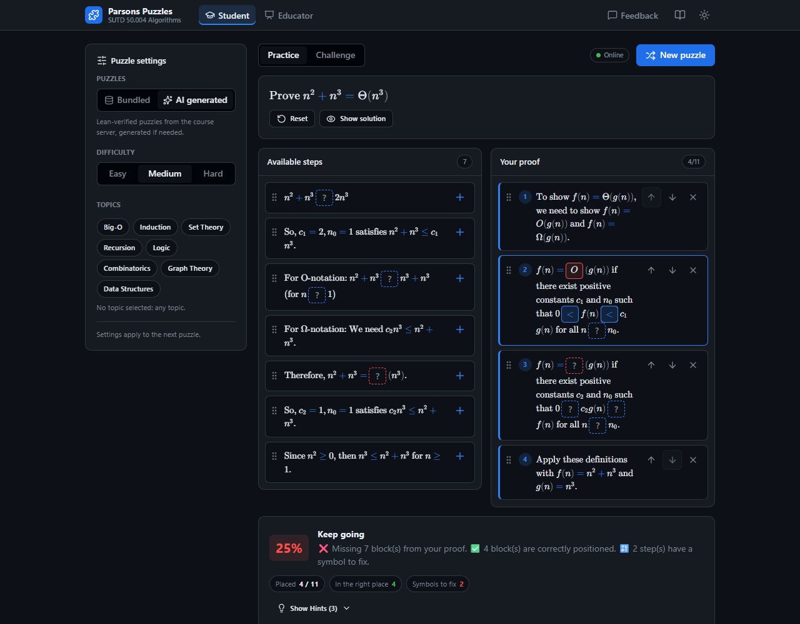
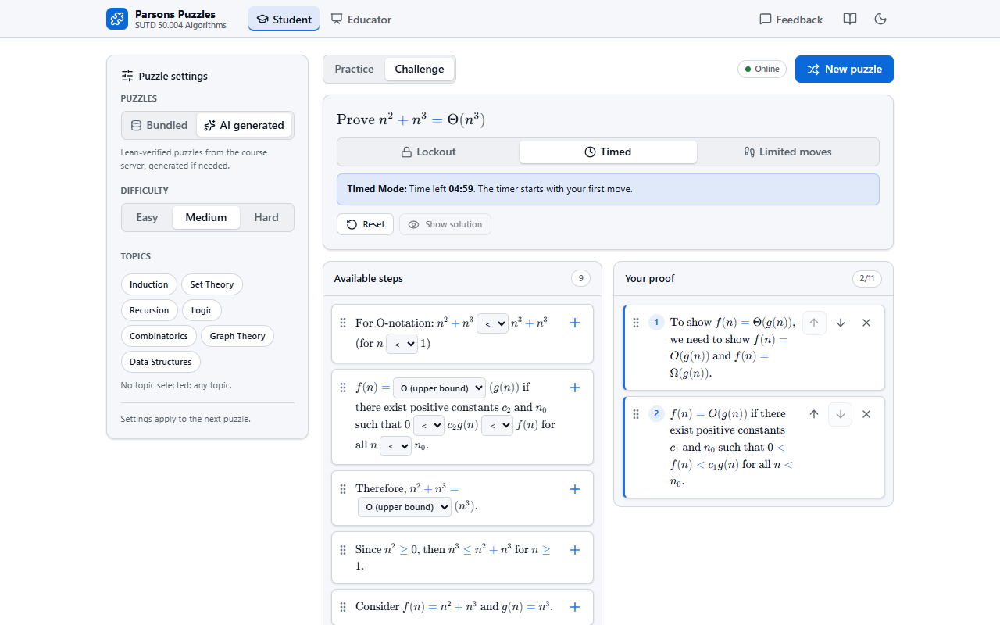
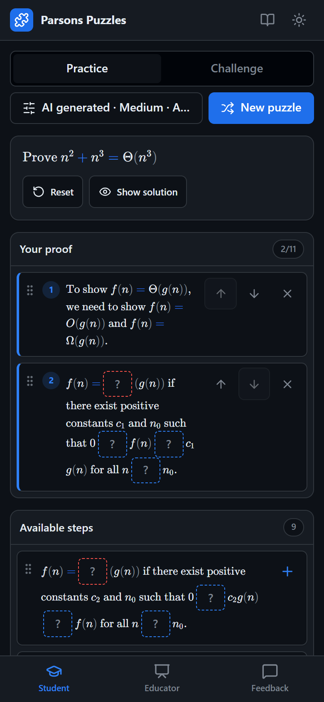
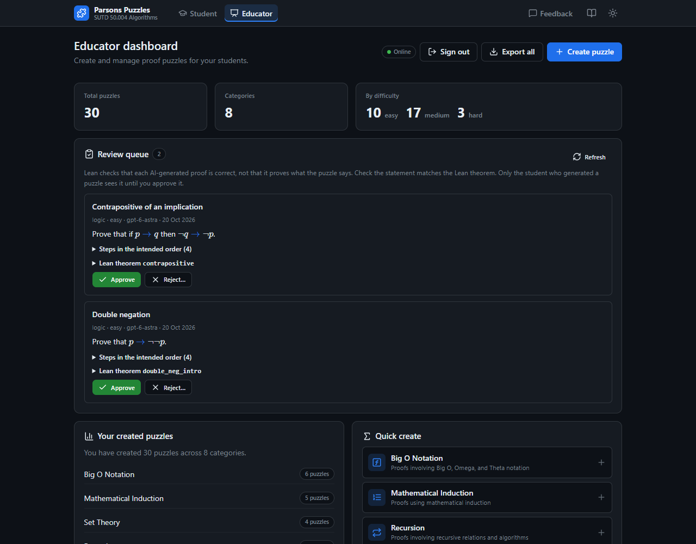
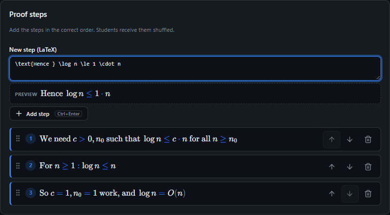

# Parsons Puzzles SUTD

A web app for practising mathematical proofs in SUTD 50.004 Algorithms. Students rebuild a proof by putting shuffled steps in order. Educators publish their own puzzles, and Astra generates new ones with OpenAI, checking every proof with Lean 4 first.

**Documentation is in the [wiki](https://github.com/TimSeah/ParsonsPuzzleSUTD/wiki).**



## Features

### For students

- Drag steps into place, or tap **+** and reorder with ↑ / ↓. Works on desktop and phones.
- **Practice** mode gives a score and hints as you go.
- **Challenge** mode hides the result until you submit, with Lockout, Timed (5 minutes) and Limited moves (20) rules.
- Pick bundled puzzles or AI-generated ones by difficulty and topic.
- Built-in dictionary of terms, light and dark themes, and a feedback form.

<table>
  <tr>
    <td></td>
    <td width="30%"></td>
  </tr>
</table>

### For educators

- Sign in with the shared educator key (`EDUCATOR_KEY` in `backend/.env`) to publish puzzles. Anyone can browse the dashboard.
- Dashboard with puzzle counts by category and difficulty.
- Write LaTeX with a live preview, reorder steps, and try the puzzle as a student before publishing.
- Add clickable symbols with their answer, such as `{{op:\leq}}` or `{{complexity:\Theta}}` (use `|` for alternatives: `{{op:\leq|<}}`). Students click to cycle through the symbols, and the symbol is graded with the step.

<table>
  <tr>
    <td></td>
    <td></td>
  </tr>
</table>

### Lean-verified generation

When a student asks for an AI-generated puzzle, the backend reuses a verified puzzle they haven't seen or asks OpenAI for a new one with a complete Lean proof. A Lean 4 + Mathlib worker compiles the proof and rejects `sorry`, extra axioms and warnings. Each student-facing step must match a fragment of that proof. Lean checks the maths, not the English wording, so generated puzzles still benefit from review. See [Generation and verification](https://github.com/TimSeah/ParsonsPuzzleSUTD/wiki/Generation-and-Verification).

## Quick start

Needs Node.js 22.12 or newer.

```bash
git clone https://github.com/TimSeah/ParsonsPuzzleSUTD.git
cd ParsonsPuzzleSUTD
npm start
```

On Windows you can double-click `start.cmd`; on macOS or Linux run `./start.sh`. Both only run `npm start`, which asks before installing dependencies, then starts the frontend, plus the API and Lean worker if they are set up. Without a backend the app uses its bundled puzzles. `npm run doctor` checks your setup and explains what's missing.

No local installs: open the repo in GitHub Codespaces or a VS Code dev container for Node and MongoDB ready to go. For the full setup (database, OpenAI, Lean) see [Getting started](https://github.com/TimSeah/ParsonsPuzzleSUTD/wiki/Getting-Started) and [CONTRIBUTING.md](CONTRIBUTING.md), or use Docker:

```bash
docker compose up --build                        # frontend, backend, MongoDB
docker compose --profile generation up --build   # plus the Lean worker
```

## Repository

| Folder | Contents |
| --- | --- |
| [`frontend/`](frontend) | React + Vite app |
| [`backend/`](backend) | Express API, MongoDB models, generation service |
| [`lean-worker/`](lean-worker) | Lean 4 proof checker |

Common commands, run from the root: `npm run dev:fullstack`, `npm test`, `npm run lint`, `npm run build`. The full list is on [Development](https://github.com/TimSeah/ParsonsPuzzleSUTD/wiki/Development).

## Documentation

| | |
| --- | --- |
| Using the app | [Student guide](https://github.com/TimSeah/ParsonsPuzzleSUTD/wiki/Student-Guide) · [Educator guide](https://github.com/TimSeah/ParsonsPuzzleSUTD/wiki/Educator-Guide) · [Sample puzzles](https://github.com/TimSeah/ParsonsPuzzleSUTD/wiki/Sample-Puzzles) |
| Running it | [Getting started](https://github.com/TimSeah/ParsonsPuzzleSUTD/wiki/Getting-Started) · [Configuration](https://github.com/TimSeah/ParsonsPuzzleSUTD/wiki/Configuration) · [Database](https://github.com/TimSeah/ParsonsPuzzleSUTD/wiki/Database) · [Deployment](https://github.com/TimSeah/ParsonsPuzzleSUTD/wiki/Deployment) · [Troubleshooting](https://github.com/TimSeah/ParsonsPuzzleSUTD/wiki/Troubleshooting) |
| How it works | [Architecture](https://github.com/TimSeah/ParsonsPuzzleSUTD/wiki/Architecture) · [Generation and verification](https://github.com/TimSeah/ParsonsPuzzleSUTD/wiki/Generation-and-Verification) · [API reference](https://github.com/TimSeah/ParsonsPuzzleSUTD/wiki/API-Reference) · [Puzzle format](https://github.com/TimSeah/ParsonsPuzzleSUTD/wiki/Puzzle-Format) |

There is no login yet. Read [Deployment](https://github.com/TimSeah/ParsonsPuzzleSUTD/wiki/Deployment#before-going-public) before putting the app on a public server.
